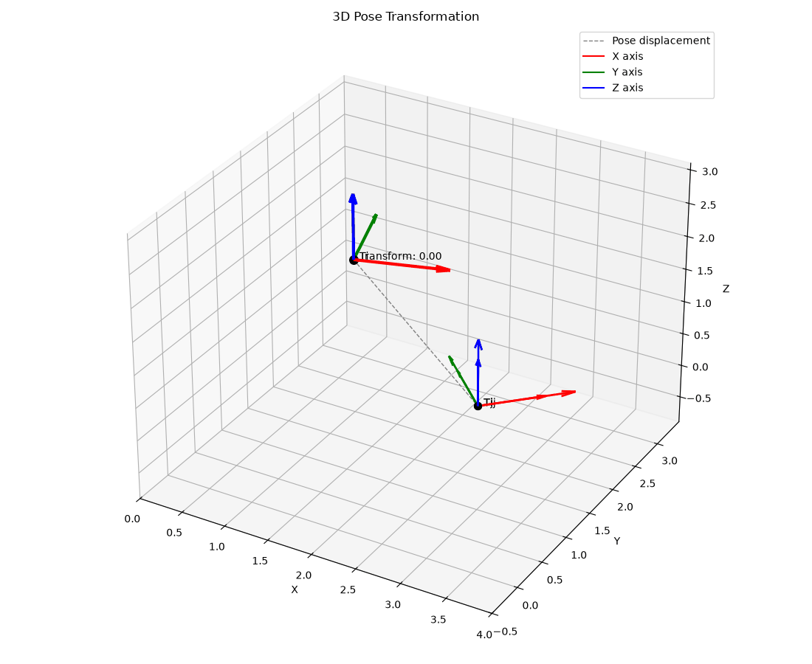

# SLAM Optimization Tutorial

---

## Install deps
```bash
# 1. Eigen3
sudo apt install libeigen3-dev

# 2. GTSAM
git clone --branch 4.2a0 https://github.com/borglab/gtsam.git

cd gtsam
mkdir build
cd build

cmake .. \
    -DCMAKE_BUILD_TYPE=Release \
    -DGTSAM_BUILD_TESTS=OFF \
    -DGTSAM_BUILD_EXAMPLES=OFF \
    -DGTSAM_BUILD_UNSTABLE=OFF

make -j$(nproc)

sudo make install

sudo ldconfig

# 3. Ceres
sudo apt install -y libceres-dev libgoogle-glog-dev libgflags-dev libeigen3-dev libsuitesparse-dev
```

---

## Build

```bash
mkdir build
cd build
cmake ..
make -j$(nproc)
```

---

## Visualize

```bash
# install python deps
conda install numpy pandas matplotlib pillow

# run
python3 visualize_poses.py ../data/Ti.csv ../data/Tj.csv ../data/Tij.csv
```

The animation below visualizes the relative transformation between two 3D poses.

<p align="center">
  
</p>

The relative transformation is applied as:

$$
T_2 = T_1 T_{12}
$$

where:

- $T_1$ — initial pose
- $T_{12}$ — relative transformation
- $T_2$ — predicted final pose

---

## Refs
- [ceres slam tutorial](https://github.com/ceres-solver/ceres-solver/tree/master/examples/slam/pose_graph_3d)